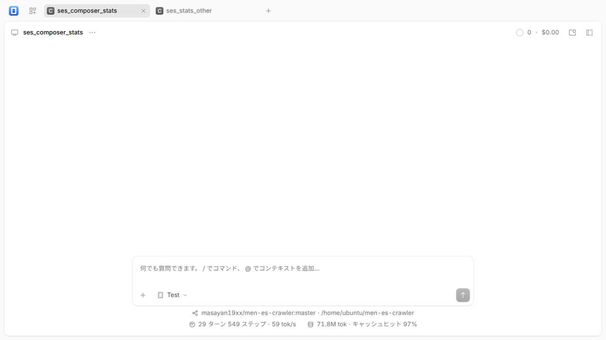

# opencode-fork-ops

[akiyan/opencode](https://github.com/akiyan/opencode) の独自版を運用するためのルール、固定バージョン、ビルド・更新手順です。

## 構成

- 本家: [anomalyco/opencode](https://github.com/anomalyco/opencode)
- fork: [akiyan/opencode](https://github.com/akiyan/opencode)、運用ブランチ `akiyan`
- このリポジトリ: 運用情報とスクリプト
- 独自変更: プロンプト入力欄の下にリポジトリ・ブランチ・作業パスとセッション統計を3行表示

fork は **固定した upstream コミット + 独自コミット1つ** を維持します。公式の `dev` / `v2` ブランチには独自変更を載せません。採用する SHA は [config/source.lock.json](config/source.lock.json) で固定します。

## ビルド済みバイナリ

Linux x86_64 向けは [v2.1.2-akiyan.1](https://github.com/akiyan/opencode-fork-ops/releases/tag/v2.1.2-akiyan.1) から取得できます。アーカイブに含まれる `opencode` をこのリポジトリの `dist/opencode` に配置すると、以下の `scripts/run.sh` を利用できます。

ビルド済みバイナリの実行に Bun は不要です。このリポジトリ内で、GitHub CLI を使う場合の手順:

```sh
mkdir -p dist
gh release download v2.1.2-akiyan.1 --repo akiyan/opencode-fork-ops --pattern '*linux-x86_64.tar.gz*' --dir dist
(cd dist && sha256sum -c opencode-2.1.2-akiyan.1-linux-x86_64.tar.gz.sha256 && tar -xzf opencode-2.1.2-akiyan.1-linux-x86_64.tar.gz)
./scripts/run.sh
```

## ビルド

Bash 4 以降、Git、Bun 1.4.2、Python 3、tar が必要です。fork を隣の `../opencode` に配置します。

```sh
git clone https://github.com/akiyan/opencode-fork-ops.git
git clone https://github.com/akiyan/opencode.git
cd opencode-fork-ops
# source.lock.json の fork_commit を checkout する
python3 -c 'import json; print(json.load(open("config/source.lock.json"))["fork_commit"])'
git -C ../opencode checkout <表示されたSHA>
./scripts/verify.sh
./scripts/build.sh
```

成果物は `dist/` に保存します。GitHub Actions の **Build fork** を手動実行して、Linux x64 の成果物を取得することもできます。

## 試運転

```sh
./scripts/run.sh
```

既定で `127.0.0.1:4496` に起動します。パスワードは対話入力し、端末出力や公開ファイルへ保存しません。データ・設定・状態・キャッシュは `.runtime/` に分離します。ブラウザで表示された URL を開き、入力したパスワードで接続してください。自動更新は無効です。

既存サービスへの切替は、隔離環境で確認した後に行います。既存の `opencode` / `opencode2` はスクリプトで置き換えません。

- [更新・切替・ロールバック](docs/operations.md)
- [数値の定義と制約](docs/metrics.md)
- [検証記録](docs/validation.md)

## 表示例

テスト用データを使用しています。



[スマートフォン幅の表示](docs/assets/composer-stats-mobile.png)
